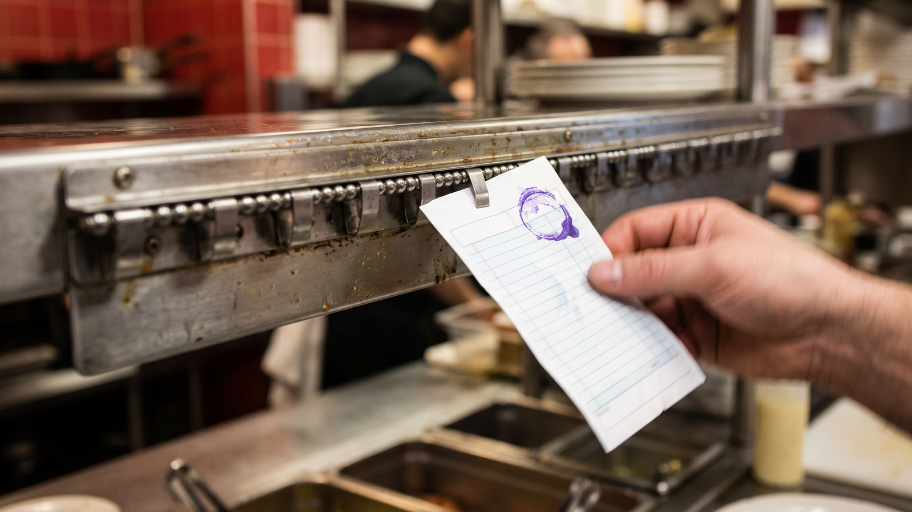
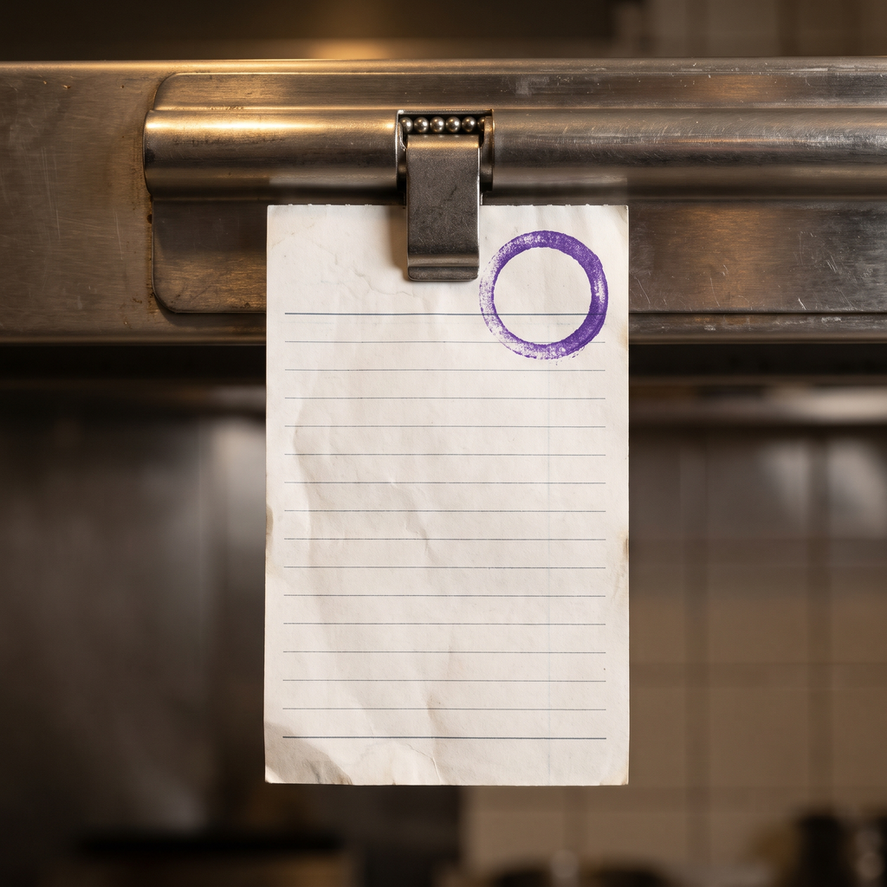
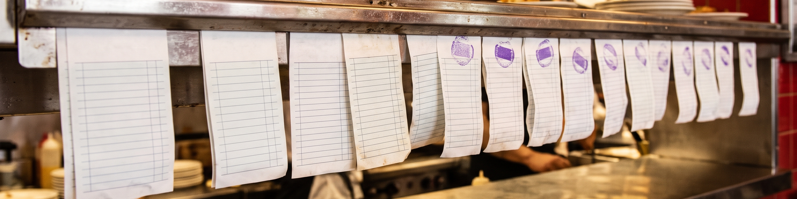

# PR-Dashboard

A Pull request dashboard that shows various data on pull requests

Three pieces:

- `status.md` and `main.py`: a merged-pull-request counter. A scheduled
  workflow runs `main.py`, which reads the count out of `status.md`,
  advances it by one, and writes it back in the same format; the workflow
  then opens a pull request with the updated file.
- `dashboard.html`: a standalone page that fetches this repository's pull
  requests from the GitHub API and lists them in a table.
- `pull-request-check.py`: an interactive exporter that asks for a
  repository and a file name and writes its pull requests to CSV,
  including comment and changed-file counts fetched per pull request.

